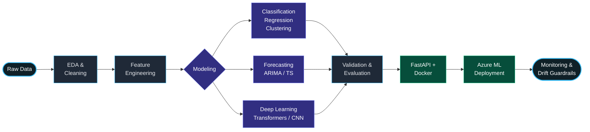
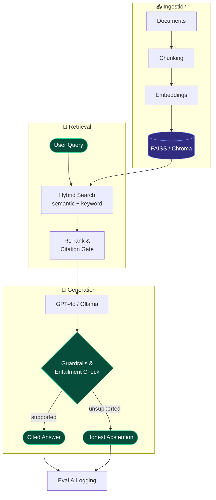

# 🚀 Engineering Production-Grade ML Systems & RAG Blueprints

A battle-tested architectural standard and end-to-end execution guide for building, validating, shipping, and monitoring robust Machine Learning and LLM systems from scratch.

## 🏗️ Part 1: How to Build an End-to-End ML System

The step-by-step pipeline from raw data acquisition to continuous monitoring in production:

```text
[Raw Data] ──> [EDA & Cleaning] ──> [Feature Engineering] ──> [Model Training] ──> [Validation & Eval] ──> [FastAPI + Docker] ──> [Azure ML Deployment] ──> [Monitoring & Drift Guard]

```

### 📋 The ML Execution Flow



| Stage | What I Actually Do | Key Tools & Practices |
| --- | --- | --- |
| **🔍 Explore** | Statistical EDA, hypothesis & A/B testing, data quality auditing | Pandas, NumPy, SciPy |
| **🧱 Engineer** | Feature design, encoding, scaling, leakage checks, PySpark pipelines | Scikit-Learn, PySpark |
| **🧠 Model** | Random Forest, Gradient Boosting, ARIMA, CNN, transfer learning, fine-tuning | PyTorch, Hugging Face, XGBoost |
| **📏 Validate** | Cross-validation, metric selection, error analysis, calibration | MLflow, Scikit-Learn Metrics |
| **🚀 Ship** | FastAPI services, Docker images, CI/CD on GitHub, Azure ML | FastAPI, Docker, GitHub Actions, Azure |
| **📡 Monitor** | Drift detection, prediction-quality checks, safety guardrails | Evidently AI, Prometheus |

---

##   Part 2: How to Build a Production RAG System

For applications incorporating Large Language Models, deterministic retrieval and safety checks are non-negotiable.

The core creation flow moves sequentially across three phases:

```text
[Documents / Raw Text] ──> [Ingestion & Chunking] ──> [Vector Database Storage]
                                                            │
[User Query] ──> [Hybrid Search] ◄──────────────────────────┘
                      │
                      ▼
               [Re-rank & Citation Gate]
                      │
                      ▼
               [LLM Generation (GPT-4o / Ollama)]
                      │
                      ▼
               [Entailment & Safety Guardrails] ──(Supported)──> [Cited Answer]
                                                ──(Unsupported)─> [Honest Abstention]

```

### 🧠 The RAG Architecture Flow



---

## 🛠️ Core Engineering Principles

1. **Reproducibility First:** Lock dependencies and track experiments rigorously with version control and MLflow.
2. **Defensive Modeling:** Never deploy a model without strict cross-validation splits and performance calibration.
3. **Guardrails over Raw Output:** Ensure RAG responses pass entailment checks to eliminate hallucinations.
4. **Containerized Deployments:** Package microservices via Docker and serve through high-performance async APIs (FastAPI).

---

## 📂 Repository Structure

```text
├── .github/workflows/      # CI/CD automation pipelines
├── data/                   # Raw & processed data assets
├── notebooks/              # Exploratory data analysis & prototyping
├── src/
│   ├── features/           # Feature engineering & transformation pipelines
│   ├── models/             # Training, fine-tuning, & evaluation scripts
│   ├── ingestion/          # RAG document parsing, chunking & embeddings
│   ├── retrieval/          # Vector stores & hybrid search modules
│   └── api/                # FastAPI application endpoints
├── Dockerfile              # Container configuration
├── requirements.txt        # Project dependencies
└── README.md

```

```

```
